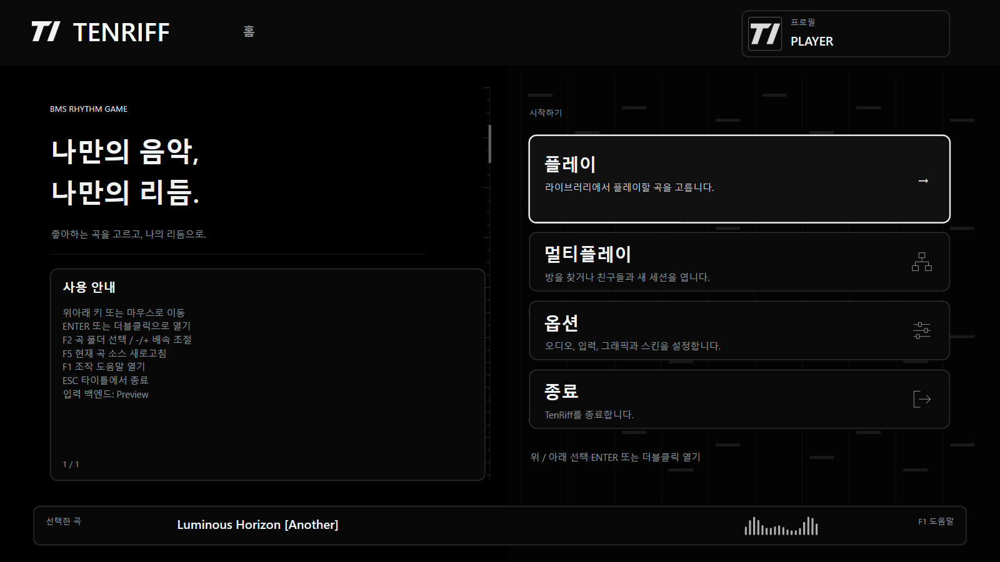
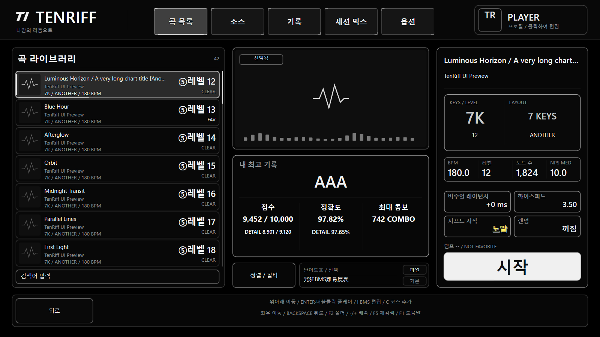
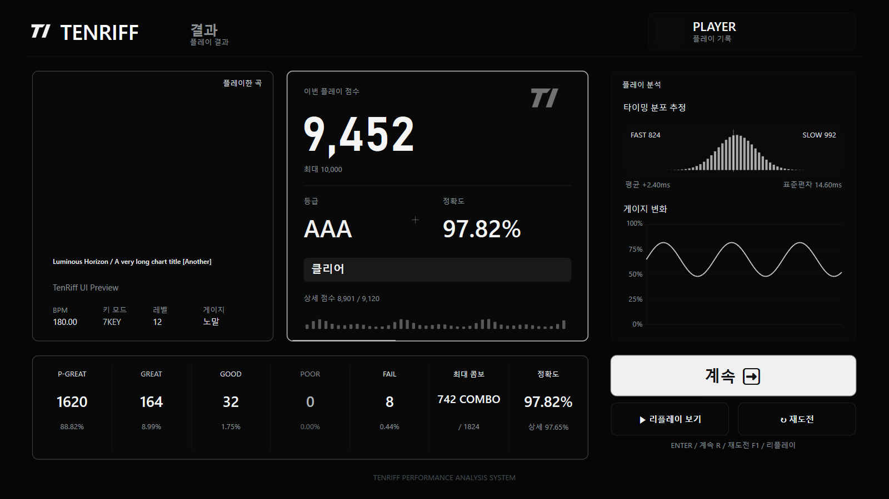
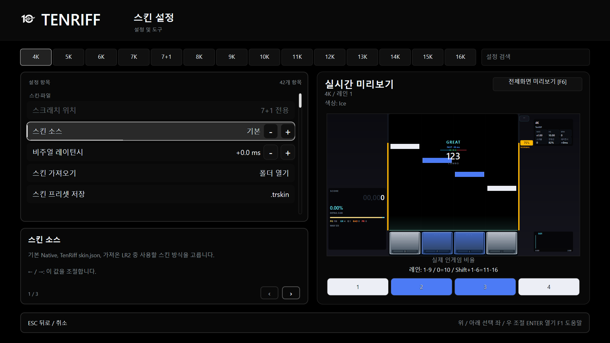

# TenRiff

**2026-10-13 · 1.8.9.6:** Reuse high-resolution timers for short input and gameplay/HUD waits; RawInput wakes on messages. Ships the B comparison behavior while preserving judgement windows, R1–R5, replays and the fixed 1.8.7 baseline. Manual impressions varied between runs; this does not guarantee removal of every stutter. [Scope / 검증](docs/release-1.8.9.6-gate.md).

**2026-10-13 · 1.8.9.5:** R5 processes LN tails and automatic judgements in time order, separates judgement from audio write-ahead, and aligns input/display timing with exact BPM/STOP scroll positions. Restores dark lobby cards with colored icons and moves Master Volume first. R1–R4 and the fixed 1.8.7 baseline are preserved. [Scope and verification](docs/release-1.8.9.5-gate.md).

**2026-10-13 · 1.8.9.4:** Rearranges the large result rank and score, shows detail accuracy and distinguishes four Gauge Shift CLEAR colors. BGM/keysound volume move to the top of Audio with 100% defaults for new settings. Includes Korean skin-label revisions, explicit obj credits, BPM! changes and correction of duplicate identical audio at the same chart time. Author uploads are optional and existing record identities are retained. [Changes, compatibility and validation (Korean)](docs/release-1.8.9.4-gate.md). Verification and game/web publication are tracked separately; the fixed baseline remains 1.8.7.

**2026-10-13 · 1.8.9.3:** Refines result typography, colored lobby cards with subtle bloom, skin-colored key bindings and song-list level colors. Removes indicator backings and the target-gap/visual-preset controls, placing Target Lane directly above Note Color. [Changes and verification scope (Korean)](docs/release-1.8.9.3-gate.md). Fixed baseline remains 1.8.7; 1.8.9.2 BMS correction and replay compatibility are retained.

**2026-10-13 · 1.8.9.2:** Coalesces a BMS tap and long-note head at the same lane/time into one playable hold before Native play or conversion. Preserves original files, hold spans and keysounds. Old replays retain their original layout. [Behavior and compatibility limits (Korean)](docs/release-1.8.9.2-gate.md). The fixed baseline remains 1.8.7.

**2026-10-13 · 1.8.9.1:** Adds sequential key binding, converter keysound/hold preservation, FAST/SLOW/timing backing controls, larger gauges, preview gear dragging and text-only judgements. Existing replays retain their original conversion. [Behavior, verification and compatibility limits (Korean)](docs/release-1.8.9.1-gate.md). The fixed baseline remains 1.8.7.

**Fixed baseline: [1.8.7](docs/baseline-1.8.7.en.md)** (2026-10-10). Use Git tag `1.8.7`, commit `6b060ad47b950ad9e0dbc516fbb40189e8e21347`; do not advance it automatically with `latest` or a new release.

**2026-10-12 · 1.8.9:** Adds larger lobby BEST numbers, key-mode colors and a white shared frame; Studio information at the upper right, score at the lower left and a horizontal riff map at the lower right; and larger result text, analysis tabs and centered actions. S+ color/font are preserved. Judge Easy/Hard selections now reach new sessions. See [behavior, verification and remaining scope](docs/release-1.8.9-gate.md) and [Judge cause and compatibility](docs/judge-session-handoff-1.8.9.ko.md) (Korean).

**2026-10-12 · 1.8.8:** Combines result analysis, free window sizing and F9 PNG hints, long LN Mix, readability updates, table URL/filter fixes, skin lane shortcuts, preserved keysounds during key-count reduction, and solo start/instant-retry controls. See the [1.8.8 release gate](docs/release-1.8.8-gate.md) for current validation, packages and publication status. The fixed baseline remains 1.8.7.

**Analysis and extension plans:** Separate lane distributions, time-based accuracy and tap/LN-head/release/hold-failure events; unmeasurable misses are never zero-ms samples. Long LN Mix v2 keeps local history/replay only and is excluded from legacy BEST and Sites uploads. Plugins and 1.9.0 stabilization remain plans. [Analysis](docs/result-analysis-1.8.8.ko.md), [display/menu/keysound changes](docs/release-feedback-1.8.8.ko.md), [start/retry controls](docs/gameplay-start-controls.ko.md) (Korean).

**2026-10-09 · TenRiff 1.8.7:** Improves input calibration and chart-loading audio, adds LR2 solo Studio Deck, 750ms FAST/SLOW retention, key reassignment, consolidated Options and complete song-title fitting. [1.8.7 release](docs/release-1.8.7-gate.md).

**2026-10-08 · TenRiff 1.8.6:** Adds the Studio Deck HUD for Native solo play. Left and right Shift work as play keys; F5/F6 halve/double Hi-Speed and F11 opens chat. Classic HUD remains selectable. [1.8.6 release](docs/release-1.8.6-gate.md).

**2026-10-06 · TenRiff 1.8.5:** Batches supported note images in drawing order during VSync-OFF gameplay to reduce CPU submission work. Unsupported skins/long notes and VSync-ON retain the existing path. Lobby/menu behavior and R1–R4 judgement/replay rules are preserved. [1.8.5 release](docs/release-1.8.5-gate.md).

**2026-10-05 · TenRiff 1.8.42:** Fixes extra render waiting when a dense frame slightly exceeds its budget, and skips performance-history collection/sorting while the overlay is off. Note visuals/count and R1–R4 judgement/replay rules are preserved. [1.8.42 release](docs/release-1.8.42-gate.md).

**2026-10-05 · TenRiff 1.8.41:** Retunes Judge Hard to EASY-baseline PG/GR/GD ±17.5/55.714286/98.571429ms. BAD is fixed across every BMS RANK at Hard ±225ms / Easy ±210ms. New records use R4; R1/R2/R3 replays and existing web records are preserved. [1.8.41 release](docs/release-1.8.41-gate.md).

**2026-10-05 · TenRiff 1.8.4:** Improves pause mouse controls and settings clicks; adds live pacemaker feedback, practice Auto Scratch and portable full-profile settings. Fixes player field sizing in ghost battle, LN opacity, HUD scanning and the frame-queue limit. [1.8.4 release](docs/release-1.8.4-gate.md).

**2026-10-04 · TenRiff 1.8.3:** Adds fullscreen skin previews, note fog, independent FAST/SLOW placement and a simple square skin. Fixes hidden compression with Normalize OFF and pause/resume visibility; adds song-ending choices, immediate LN release judgement and R3 timing based on BMS RANK. [1.8.3 release](docs/release-1.8.3-gate.md).

**2026-10-03 · TenRiff 1.8.2:** Adds ten vivid Options icon colors, rounded selection borders matching each icon, corrected FAST/SLOW bar visibility and matching skin-editor previews. [1.8.2 release](docs/release-1.8.2-gate.md).

**2026-10-03 · TenRiff 1.8.1:** Adds 18 functional icons and a portable PNG skin, with black options and Song Select surfaces. Includes contextual option help, GPT Sites rankings inside Records, and Left/Right key-test layout selection from 4K to 16K. [1.8.1 design notes](docs/menu-studio-1.8.1.ko.md).

**Multiplayer Rate build:** the leader sets a shared Room Rate in the lobby. All participants must use this protocol v6 build; previous v5 clients cannot join. [Guide (Korean)](docs/multiplayer.md).

Release and downloads: [**1.8.9.5 Sites integrated**](https://github.com/10kseason/TenRiff/releases/tag/1.8.9.5). Actual package/publication status is tracked in the [release record](docs/release-1.8.9.5-gate.md); the fixed baseline remains 1.8.7. Extract to a new folder, run `launch_win.bat`, then press F10 and link your web account once. Eligible new plays upload score, detail score, accuracy, and detailed accuracy. New plays use ruleset-5 with a required timing profile for web submissions; ruleset-1/2/3/4 replays retain their original timing and LN behavior, and existing web records keep their IDs and scores. See the [connection guide](docs/sites-leaderboard.md) (Korean).

Language: [한국어](README.md) | [English](README.en.md) | [简体中文](README.zh-CN.md) | [日本語](README.ja.md)

TenRiff is a Windows GUI BMS rhythm-game runtime/launcher. The fixed baseline is `1.8.7` and this source targets `1.8.9.5`, and chart input is limited to the BMS family (`.bms/.bme/.bml/.pms`). Graphics Settings lets users select a rights-cleared external ONNX model for the optional BGA Upscaler. Public packages contain no BGA-upscaler model; key-mode conversion bundles the deterministic NK3 P64 graph and the generalized pattern MLP exports. The project uses the MIT License, and bundled third-party notices are collected in [`THIRD_PARTY_NOTICES.md`](THIRD_PARTY_NOTICES.md).

This README explains what to read first when opening the project. For current behavior, the `1.8.9.5` release line, the fixed `1.8.7` baseline, configuration and design documents, continue from [`docs/README.en.md`](docs/README.en.md).

TenRiff should also be read as a `vibe coding` work: it was shaped through fast iteration and experimentation rather than only through a traditional long-form design-first process.

## 1.8.1 Studio menu skin

Adds 18 functional icons and a portable PNG skin, with black options and Song Select surfaces. Includes contextual option help, GPT Sites rankings inside Records, and Left/Right key-test layout selection from 4K to 16K.

[Design / skin controls](docs/menu-studio-1.8.1.ko.md) · [Release verification](docs/release-1.8.1-gate.md) · [CHANGELOG](CHANGELOG.md)

## Screenshots

### Home

Start playing, join multiplayer, or open settings from one screen.



### Song Select

Browse charts, check personal bests, and select a difficulty table.



### Results

Review scores, judgement counts, the estimated timing distribution, and gauge history.



### Skin Settings

Adjust lanes and notes while checking the live preview.



## Project At a Glance

- Primary target platform: Windows
- Supported charts: BMS family only (`.bms/.bme/.bml/.pms`)
- Graphics path: D3D11 + Direct2D/DirectWrite
- Audio path: WASAPI (default), native ASIO (requires a Windows x64 driver)
- Input path: RawInput or high-rate polling
- Direct-IP/headless-server multiplayer: fixed TCP coordinator for up to 8 players, BMS-only shared charts, and `F8` chat (default `27301/TCP`; see [usage](docs/multiplayer.md))
- License: [MIT](LICENSE)
- Third-party notices: [THIRD_PARTY_NOTICES.md](THIRD_PARTY_NOTICES.md)
- Release changelog: [CHANGELOG.md](CHANGELOG.md)

## Credits / Attribution

TenRiff's current key-mode converter implementation includes an adaptation/port based on the N2NC idea and code from `krrcream-Toolkit`.

- Original project: <https://github.com/krrcream/krrcream-Toolkit>
- Applied scope: porting the key-mode conversion logic from `Tools/N2NC/N2NC.cs` into TenRiff's C++ `GameplayChart` structure
- Current TenRiff implementation location: `src/gameplay/KeyModeConverter.*`
- License / source notice: [`THIRD_PARTY_NOTICES.md`](THIRD_PARTY_NOTICES.md)

Whenever possible, the original author `krrcream` and the upstream toolkit are kept credited, and TenRiff-side changes/integration details are described separately.

### Thanks

Thanks to OpenAI Codex, ChatGPT, Claude Code, Gemini, and the guest testers who helped validate the project.

## What You Can Do Now

The codebase is currently at the level where you can "open the menu, choose a song, load a chart, play it, and review the result and local records."

- BMS parser / normalizer / timeline handling
  - Headers, dictionaries, and measure commands
  - `#MEASURE` fraction handling
  - Compact lane mapping by declared key count when `#4K / #6K / #8K` headers are present
  - `#LNOBJ`, LN channels (`51`-`55`, `61`-`65`)
  - CP932 (Shift-JIS) legacy BMS text support
- BMS audio handling
  - Native WAV decoding
  - Native OGG Vorbis decoding via `stb_vorbis`, with a Windows Media Foundation fallback if needed
  - MP3 via Windows Media Foundation fallback
  - `ffmpeg.exe` fallback when needed
  - `follow / autoplay / ignore` keysound mode
  - Late real-time inputs keep their judgement timestamp while only the audible trigger is pinned to the current writable buffer boundary, preventing short keysounds from being skipped completely
- Song Select
  - Cache-first loading
  - `F5` forced reindexing with centered stage / percent / ETA progress
  - Search, key-count filtering, difficulty filtering
  - `LV ASC/DESC`, `TITLE A-Z/Z-A` sorting
  - External folder / BMS drag-and-drop
  - Recent source persistence / reopening
  - `-` / `+` adjusts the next-play Rate immediately
  - Browse can select a local BMS difficulty-table JSON and apply table levels to MD5/SHA-256 matches
- Gameplay / HUD
  - Real-time HUD
  - Staged chart-loading progress
  - `Esc` cancels ordinary gameplay loading; Session Mix ignores Esc
  - Display offset
  - Performance overlay
  - Note head/tail bitmap cache + static playfield command-list cache
  - Ghost Battle defaults to `OFF` for new/missing-key settings while preserving an existing explicit opt-in
- Options / skins
  - Hi-Speed, Rate, gauge, audio, input, and graphics settings
  - Judgement-line position, note size, and lane color editing in the `Skins` screen
  - `4K–10K / 12K / 14K / 16K / 7+1` lane color editing with a live preview
  - Native vector, TenRiff `skin.json`, and LR2 playskins
  - Completed skins under the packaged `skins/` directory appear by default; a profile skin with the same name takes precedence
  - LR2 skin-folder selection or drag-and-drop copies into the active profile and imports note, LN, lane-gap, and destination-size data
- Results / local and read-only online records
  - Result screen
  - Replay / result JSON export
  - Per-song local record accumulation
  - Best-record selection with clear-status priority

## What Is Still Limited

The project is usable, but it is not yet a fully finished product.

- Windows GUI is the main path.
- Linux GUI/audio/input backends are still incomplete.
- LR2 playskin import ports supported gameplay elements; it does not claim pixel-perfect reproduction of the full LR2 UI.
- Some GUI paths are validated primarily through build/tests, and manual in-game verification still remains.
- Older design documents and the current implementation may differ in places, so the current-state document should always be consulted first.

## Quick Start

### 1. Prepare the repository layout

These directories are the usual entry points:

- `src/`: runtime/game code
- `tests/`: unit and smoke tests
- `docs/`: current-state and design documents
- `config/`: global default config
- `profiles/`: runtime profiles, keymaps, local results
- `songs/`: chart root

### 2. Release build

The following is a typical Windows build example:

```powershell
cmake -S . -B build-dist -G "Visual Studio 17 2022" -A x64
cmake --build build-dist --config Release --target tenriff
cmake --build build-dist --config Release --target bms_parser_tests
```

If Windows Defender or another antivirus briefly locks `TenRiff.exe`, rerun the same `cmake --build` command after the lock is released.

### 3. Public source packages can be built directly too

The versioned public source bundles (packages such as `TenRiff-1.2.1-source.zip`) include `external/` except `external/llama.cpp/`, `src/`, `tests/`, `config/`, `docs/`, and `Mainmusic/`, so they can be configured and built directly after extraction.

- The public source bundle does not depend on local build wrappers; use the plain `cmake --build` flow shown above.
- `10k-calc/` is intentionally excluded from the public source bundle, so optional Python-reference checks may print `[skip]` and still be considered normal.
- `external/llama.cpp/` is also intentionally excluded, so any local LLM/tooling checkout must be restored separately.
- `profiles/`, `songs/`, and `logs/` are also excluded from the bundle, but `launch_win.bat` creates the needed folders on first launch.

Inside the extracted source-package folder, a typical flow looks like this:

```powershell
cmake -S . -B build -G "Visual Studio 17 2022" -A x64
cmake --build build --config Release --target tenriff
cmake --build build --config Release --target bms_parser_tests
.\build\Release\bms_parser_tests.exe
```

### 4. Run the tests

```powershell
.\build-dist\Release\bms_parser_tests.exe
```

### 5. Run the app

Direct launch:

```powershell
.\build-dist\Release\TenRiff.exe --songs .\songs --profile default
```

Launcher script:

```powershell
.\launch_win.bat
```

## Config and Runtime Data

TenRiff separates global config from profile config.

- Global config: `config/config.json`
- Profile config: `profiles/<name>/config.json`
- Keymap: `profiles/<name>/keymap.json`
- Song index cache: `profiles/<name>/.tenriff/song-index/<source-hash>.json`
- Replay export: `profiles/<name>/replays/*.json`
- Result export: `profiles/<name>/results/*.json`
- Runtime log: `logs/run.log`
- Crash log: `logs/crash-*.log`

For a detailed look at the config structure, the fastest starting point is [`docs/config.en.md`](docs/config.en.md).

## Reading Order

This README only covers the introduction. For the details, the most efficient reading order is:

1. [`docs/README.en.md`](docs/README.en.md)
   - Full documentation map
2. [`docs/current-state.en.md`](docs/current-state.en.md)
   - What actually works right now
3. [`docs/baseline-1.8.7.en.md`](docs/baseline-1.8.7.en.md)
   - The `1.8.7 fixed stable baseline` baseline document that follow-up work should use as a reference
4. [`docs/gameplay-guide.en.md`](docs/gameplay-guide.en.md)
   - How to start playing, basic controls, HUD/judgement/result screen explanation from a practical player perspective
5. [`docs/config.en.md`](docs/config.en.md)
   - Config/profile/keymap structure
6. [`docs/menu.en.md`](docs/menu.en.md)
   - Menu / state machine / song-select flow
7. [`docs/core-loop.en.md`](docs/core-loop.en.md)
   - Play loop and data flow
8. [`docs/roadmap.en.md`](docs/roadmap.en.md)
   - Long-term direction for future work

## Document Interpretation Rules

Design documents and the current code may appear to disagree. In that case, the priority order is:

1. Current code
2. [`docs/current-state.en.md`](docs/current-state.en.md)
3. [`docs/config.en.md`](docs/config.en.md)
4. Older design documents

In other words, when judging "current behavior," the current-state document should take precedence over older design notes.

## What To Read Next

- If you want to know how to actually play, read [`docs/gameplay-guide.en.md`](docs/gameplay-guide.en.md)
- If you want to understand the settings, read [`docs/config.en.md`](docs/config.en.md)
- If you want to understand the menu flow, read [`docs/menu.en.md`](docs/menu.en.md)
- If you want to understand the play loop, read [`docs/core-loop.en.md`](docs/core-loop.en.md)
- If you want a quick overview of the overall state, read [`docs/current-state.en.md`](docs/current-state.en.md)
